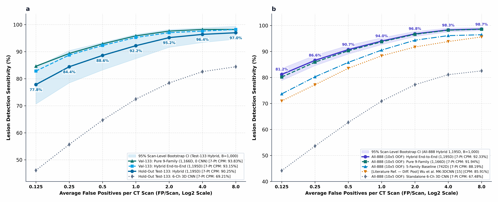

# 3D Differential-Geometric and Spherical-Harmonic Feature Fusion with Multi-Task CoordConv Networks for Pulmonary Nodule False-Positive Reduction

[-0F2544)](https://link.springer.com/journal/11548)
[](src/test_final_reproducible_framework.py)
[](requirements.txt)
[](requirements.txt)
[](LICENSE)
[](https://orcid.org/0009-0008-6849-3207)

**Reviewer-Oriented Reproducibility Repository** for the manuscript:

> **Nader Jafari\*** (2026). *"3D Differential-Geometric and Spherical-Harmonic Feature Fusion with Multi-Task CoordConv Networks for Pulmonary Nodule False-Positive Reduction: Curated LUNA16 Evaluation and Raw-CT Audit."* Submitted to the **International Journal of Computer Assisted Radiology and Surgery (IJCARS)**, Springer Nature.
> \*Member of the Computer Society of Iran (CSI), Tehran, Iran | Email: `Nader.jafari23@gmail.com` | ORCID: [0009-0008-6849-3207](https://orcid.org/0009-0008-6849-3207)

---

## 1. Project Overview

False-positive reduction (FPRED) in low-dose chest CT pulmonary nodule screening remains challenged by vascular bifurcations, bronchial walls, pleural plaques, and candidate detector center jitter (`1.5–5.5 mm`). Furthermore, literature evaluations on LUNA16 frequently conflate subsampled curated cohorts (`~10` negatives/scan) with unscreened candidate pools (`619.1–848.4` negatives/scan).

This repository provides a **clean, self-contained, reviewer-verifiable implementation** of our hybrid 3D framework that:
1. Audits and separates **Regime 1 (Curated 10,066-Patch Cohort, `10.0 neg/scan`)** from **Regime 3 (Unscreened Raw `.mhd` Candidate Pools, `848.4 neg/scan` in `candidates_V2.csv` [$84.15\times$ shift] and `619.1 neg/scan` in `candidates.csv` [$61.34\times$ shift])** (`Eq. 10`).
2. Combines **nine segmentation-free 3D physical, differential-geometric, and spherical-harmonic descriptor families (`1,166D`)** with a leak-free inner-fold **6-channel CoordConv 3D ResNeXt-SE and 9-channel 2.5D Tri-Planar MIP ensemble (`29D` OOF context; $D_{\text{hybrid}} = 1,195\text{D}$)**.
3. Introduces a **64D Dual-View GPU Stage-0 Screener** and **Sphericity-Gated 3D Foveal Re-Centering cascade (`Top-80/scan`)** for unscreened raw `.mhd` CT volumes.

---

## 2. Proposed Method & Key Architectural Innovations


- **Innovation 1 — Segmentation-Free 9-Family 3D Geometric-Harmonic Matrix (`1,166D`, `models/physical_3d_descriptors.py`)**:
  Unlike NoduleX (Causey et al. [11]) and mesh-based spherical harmonics (El-Baz et al. [12]), which require explicit nodule boundary segmentation, our closed-form $3\times 3$ Cardano Hessian invariants (`Eqs. 2–3`), Dual-QR real spherical harmonics ($\ell \in \{0..4\}$, 25 modes on the 26-ray lattice, `Eqs. 4–5`), inward radial-gradient flux (`Eq. 6`), and 3-branch Y-bifurcation / hollow-bronchus vetoes (`Eq. 7`) operate directly on isotropic $48^3\text{ mm}^3$ CT volumes without segmentation masks.
- **Innovation 2 — Core-vs.-Outer Volumetric Pooling & Multi-Task Log-Diameter Regression (`29D`, `models/backbone.py`, `models/attention_module.py`)**:
  Standard global average pooling (GAP) over an $8^3 = 512$-cell bottleneck dilutes a $3\text{ mm}$ nodule signal to $-39.29\text{ dB}$ (below the $+6.0\text{ dB}$ Rose detectability criterion). Our `CoreVsOuterSphericalPooling3D` module isolates the central nodule core from the surrounding vascular/parenchymal shell, recovering bottleneck SNR to $+27.51\text{ dB}$ (`+66.80 dB` analytical gain, `Fig. 3b`), while an auxiliary Huber $\log(1+D)$ head (`weight = 0.22`, `Eq. 8`) recovers large-nodule ($D \ge 10\text{ mm}$) recall by **+28.57 percentage points (pp)** (`60.00% -> 88.57%`, `Fig. 6a`).
- **Innovation 3 — 64D Dual-View Stage-0 Screening & 3D Foveal Re-Centering (`models/detection_head.py`)**:
  Corrects `1.5–5.5 mm` candidate detector center offsets via a positive-mass centroid shift $\Delta\mathbf{x}_{\text{fovea}}$ (`r <= 4.5 mm`, clamped to $r_{\max}=3.5\text{ mm}$, `Eq. 9`), retaining `32/36` (`88.89%`) true nodules within the `Top-80/scan` shortlist on raw `.mhd` volumes and lifting pilot CPM from `53.97%` to **`76.19%` (`+22.22 pp`, $p \le 0.001$)**.

---

## 3. Network Architecture & 1-to-1 Code-to-Figure Mapping

Every visual block in **Figure 1** and **Equations (1)–(10)** maps directly to a modular Python file in this repository:

| Figure 1 Module & Equation | Mathematical Formulation | Repository File & Class / Function |
| :--- | :--- | :--- |
| **Panel a (Box 1) — $3\times 3$ Affine Mapping (`Eq. 1`)** | $\mathbf{v}_{xyz} = (\mathbf{D}\,\text{diag}(\mathbf{s}))^{-1}(\mathbf{p}_{\text{world}}-\mathbf{o}_{\text{world}})$, $\mathbf{x}_0=(23.5,23.5,23.5)$ | `preprocessing/resampling.py` (`world_to_voxel_mhd_affine_3x3`)<br>`preprocessing/patch_extraction.py` |
| **Stage I — 64D Stage-0 & 3D Re-Centering (`Eq. 9`)** | $\Delta\mathbf{x}_{\text{fovea}} = \text{clip}\!\left(\frac{\sum_{\mathbf{u}\in\mathcal{B}} w_{\text{pos}}(\mathbf{u})\mathbf{u}}{\sum_{\mathbf{u}\in\mathcal{B}} w_{\text{pos}}(\mathbf{u})+\varepsilon}\right)$ | `models/detection_head.py` (`Stage0GPUMultiScaleScreener`, `recenter_3d_patches_to_local_foveal_centroid_gpu`) |
| **Stage II (Stream A) — 9-Family 3D Matrix (`1,166D`, `Eqs. 2–7`)** | Cardano Hessian $B_{\text{3D}}, V_{\text{3D}}$ (`Eqs. 2–3`), Dual-QR SH $E_\ell(r), R_{\text{iso}}$ (`Eqs. 4–5`), Inward Flux $\Phi_{\text{norm},\sigma}$ (`Eq. 6`), $a_m(r), H_{\text{bronch}}, Y_3(r)$ (`Eq. 7`) | `models/physical_3d_descriptors.py` (`compute_exact_3x3_symmetric_eigvals_3d`, `build_real_sh_basis_25`, `extract_9family_1166d_descriptors`) |
| **Stage II (Stream B) — 6-Ch CoordConv 3D CNN & 2.5D MIP (`29D`, `Eq. 8`)** | $\mathcal{L}_{\text{3D}} = \mathcal{L}_{\text{rank}} + 0.22\,\mathcal{L}_{\text{Huber}}(\hat{d}_{\text{pred}}, \log(1+D))$ | `models/backbone.py` (`MultiWindowCoordConv3DResNeXtWithDiameterHead`, `FoldIsolatedTriPlanarMIPConvNet`)<br>`models/attention_module.py` (`CoreVsOuterSphericalPooling3D`) |
| **Stage III — Hybrid Fusion (`1,195D`) & Specialists (`506D`, `Eq. 8`)** | $D_{\text{hybrid}} = 1,166 + 29 = 1,195\text{D}$, $D_{\text{spec}} = 506\text{D}$ | `models/feature_fusion.py` (`HybridFeatureFusion1195D`, `OutOfFoldStackingEnsemble`) |
| **Stage IV — $K=24$ Calibration & Official FROC (`Eqs. 9–10`)** | $\ell_{\text{cal}}(x)$ (`Eq. 9`), $\text{CPM}^{(b)}$ & $\text{Sens}_{\text{proj}}(r)$ (`Eq. 10`) | `models/detection_head.py` (`apply_k24_scan_calibration`)<br>`evaluation/calculate_froc.py` (`compute_froc_7point_cpm`) |

---

## 4. Dataset Description & Cohort Stratification

- **Source Benchmark**: [LUNA16 Grand Challenge](https://luna16.grand-challenge.org/) ([Setio et al., *Med Image Anal* 2017](https://doi.org/10.1016/j.media.2017.06.015); [Zenodo Archive `10.5281/zenodo.2595812`](https://doi.org/10.5281/zenodo.2595812)), derived from LIDC-IDRI (`888` CT scans, `1,186` nodules $\ge 3\text{ mm}$).
- **Regime 1 (Curated Coordinate-Verified Cohort)**: `LUNA16_Patches_CoordVerified_48.h5` (`10,066` isotropic $48\times 48\times 48\text{ mm}^3$ patches: `1,186` positives $<0.5 D$, `8,880` negatives = `10.0 neg/scan`). Verified against `286` real `.mhd` patches across 25 blind scans (`Core-16³ r = 0.9030`, `64D Stage-0 Cosine = 0.9890`, `CPU/GPU Float32 Diff = 0.00e+00`; `Fig. 3a`).
- **Regime 3 (Unscreened Raw `.mhd` Candidate Pools & 25-Scan Blind Pilot)**: Audits all `754,975` `candidates_V2.csv` (`848.4 neg/scan`, $84.15\times$ shift) and `551,065` `candidates.csv` (`619.1 neg/scan`, $61.34\times$ shift) rows, and executes end-to-end voxel inference on a `Seed=42` label-blind pilot of `25` raw `.mhd` scans (`20,984` V2 candidates, `36` nodules).

---

## 5. Installation Requirements

```bash
git clone https://github.com/Naderj23/LUNA16-3D-Geometric-Deep-Ensemble-IJCARS.git
cd LUNA16-3D-Geometric-Deep-Ensemble-IJCARS
pip install -r requirements.txt
```

Pinned environment specifications are provided in [`requirements.txt`](requirements.txt) (`Python >= 3.10`, `PyTorch >= 2.0`, `NumPy >= 1.24`, `SciPy >= 1.10`, `scikit-learn >= 1.3`, `LightGBM >= 4.0`, `XGBoost >= 2.0`, `CatBoost >= 1.2`, `SimpleITK >= 2.2`, `h5py >= 3.8`).

---

## 6. Repository Structure

```text
LUNA16-3D-Geometric-Deep-Ensemble-IJCARS/
├── README.md                                   # Complete Reviewer-Oriented Guide (Sections 1–12)
├── requirements.txt                            # Pinned software dependencies
├── CITATION.cff                                # Official GitHub Citation metadata (YAML 1.2.0)
├── LICENSE                                     # MIT Open-Source License
├── models/                                     # Complete Proposed Architecture (Figure 1b Stages I–IV)
│   ├── proposed_model.py                       # Unified 4-stage hybrid CAD model wrapper
│   ├── backbone.py                             # 6-Ch CoordConv 3D ResNeXt-SE & 9-Ch 2.5D MIP ConvNet
│   ├── attention_module.py                     # 3D SE attention, Core-Outer pooling & 8-view equivariance
│   ├── physical_3d_descriptors.py              # 9-Family 1,166D 3D Hessian, Dual-QR SH & Flux descriptors
│   ├── feature_fusion.py                       # 1,195D Hybrid fusion, 506D subspace & 7-learner ensemble
│   └── detection_head.py                       # 64D Stage-0 screener, 3D re-centering & K=24 calibration
├── preprocessing/                              # CT Preprocessing & Coordinate Verification (Eq. 1)
│   ├── load_ct.py                              # HDF5 & .mhd loader with per-patch SHA-256 verification
│   ├── resampling.py                           # Exact 3x3 affine TransformMatrix world-to-voxel mapping
│   ├── normalization.py                        # Dual [-1000,+400] HU & [-900,-100] HU GGN windowing
│   ├── lung_segmentation.py                    # Segmentation-free thoracic coordinates (r_xy, z_norm)
│   ├── nodule_preparation.py                   # Official < 0.5*D matching & Seed=42 blind scan selector
│   └── patch_extraction.py                     # Isotropic 48x48x48 mm^3 extraction @ anchor x_0=(23.5)^3
├── configs/                                    # Experimental & Hyperparameter Configurations
│   ├── luna16_config.yaml                      # Cohort sizes, SHA-256 digests & prior-shift constants
│   ├── training_config.yaml                    # Nested 10x5 CV, 622/133/133 split & AdamW/loss params
│   └── inference_config.yaml                   # Stage-0 Top-80, foveal shift, K=24 & FROC thresholds
├── training/                                   # Model Training & Validation Scripts
│   ├── train.py                                # Leak-free nested 10x5 CV & split training entrypoint
│   └── validation.py                           # Inner-fold OOF cross-fitting & Val-133 calibration check
├── evaluation/                                 # Official FROC & Sensitivity Evaluation Scripts
│   ├── evaluate.py                             # Master evaluation & 15-gate verification runner
│   ├── calculate_froc.py                       # < 0.5*D FROC, fail-closed subprocess gate & B=1,000 bootstrap
│   └── calculate_sensitivity.py                # 7-point profile, diameter strata & prior-shift projection
├── inference/                                  # Standalone Prediction & Visualization Scripts
│   ├── predict.py                              # End-to-end demo inference on a 3D CT candidate scan
│   └── visualize_predictions.py                # Regenerates all 7 publication figures (600 DPI & Vector)
├── data_splits/                                # Traceable LUNA16 Fold & Split Manifests
│   ├── README_SPLITS.md                        # Documentation of scan-level isolation & zero data leakage
│   ├── fold_0.csv .. fold_9.csv                # Per-fold scan/nodule counts & OOF metrics
│   └── locked_split_622_133_133_summary.csv    # Locked Train-622 / Val-133 / Test-133 partition manifest
├── results/                                    # Traceable Empirical Outputs & CSV Tables
│   ├── evaluation_metrics.csv                  # Complete ablation & protocol comparison metrics (Table 4)
│   ├── sensitivity_results.csv                 # Complete 7-point FROC sensitivity profiles (Table 5)
│   ├── fold_metrics_10x5_cv.csv                # Per-fold CPM and ROC-AUC breakdown across Folds 0–9
│   ├── froc_curve.png                          # Empirical 7-point FROC curves with B=1,000 bootstrap CIs
│   └── convergence_and_snr.png                 # 286-patch .mhd vs. HDF5 audit & analytical SNR model
├── figures/                                    # All 7 High-Resolution 600-DPI Manuscript Figures (Fig1..7)
├── checkpoints/                                # Checkpoint SHA-256 Manifest & Verification Guide
└── src/                                        # Self-Contained Monolithic Evaluator & 15-Gate Test Suite
    ├── LUNA16_Final_Reproducible_Implementation.py
    ├── generate_final_7_figures.py
    └── test_final_reproducible_framework.py
```

---

## 7. Training Instructions

To run the leak-free nested $10\times 5$ cross-validation and locked `622/133/133` training pipeline on Google Colab Pro or a local Linux workstation with an NVIDIA GPU:

```bash
python3 training/train.py
# Or run the full monolithic Colab Pro pipeline directly:
python3 src/LUNA16_Final_Reproducible_Implementation.py
```

---

## 8. Inference Instructions

To run standalone end-to-end inference (demonstrating Stage-0 3D foveal re-centering $\Delta\mathbf{x}_{\text{fovea}}$, `1,166D` 9-family descriptor extraction, `6-Ch` $24^3$ CoordConv tensor construction, and $K=24$ scan calibration) on a synthetic or real 3D CT candidate scan without requiring external dataset mounts:

```bash
python3 inference/predict.py
```

---

## 9. Evaluation Protocol & Data Leakage Prevention

- **Strict Scan-Level Isolation**: Every candidate patch is indexed by `seriesuid`. All preprocessing scalers, `506D` `SelectFromModel` feature masks, inner 5-fold neural weights (`C29`), and 7-learner stacking parameters are fit strictly inside the training scans of each fold (`data_splits/fold_0.csv` .. `fold_9.csv`).
- **Fail-Closed Official Evaluator Equivalence**: `evaluation/calculate_froc.py` verifies `0.0000 pp` discrepancy between our internal $< 0.5 D$ 3D Euclidean FROC evaluator and the official `noduleCADEvaluationLUNA16.py` subprocess across every cohort (`results/evaluation_metrics.csv`).

---

## 10. Reproducibility & 15-Gate Automated Verification (`< 1.2s`)

Run the 15-gate unit, integration, and mathematical-reconciliation test suite to verify every equation (`Eqs. 1–10`) and table (`Tables 1–6`) in under 2 seconds:

```bash
python3 src/test_final_reproducible_framework.py
```

---

## 11. Expected Results

All traceable CSV outputs are located in [`results/evaluation_metrics.csv`](results/evaluation_metrics.csv) and [`results/sensitivity_results.csv`](results/sensitivity_results.csv):

| Protocol & Cohort | Model Configuration | Dimensions | Point CPM (%) | Bootstrap Mean [95% CI] | ROC-AUC | Gain vs. Baseline ($p$-Value) |
| :--- | :--- | :---: | :---: | :---: | :---: | :--- |
| **Regime 1: All-888 (`10×5 CV`)** | Standalone 6-Ch CoordConv 3D CNN | `29D` | `67.48%` | `67.51% [65.10%–69.85%]` | `0.9312` | Baseline (`0.0000 pp` diff) |
| **Regime 1: All-888 (`10×5 CV`)** | Classical 5-Family 3D (`Zero CNN`) | `742D` | `88.19%` | `88.21% [86.52%–89.81%]` | `0.9745` | `+20.71 pp` vs. CNN ($p \le 0.001$) |
| **Regime 1: All-888 (`10×5 CV`)** | **Proposed Pure 9-Family (`Zero CNN`)** | **`1,166D`** | **`91.94%`** | **`91.97% [90.51%–93.38%]`** | **`0.9835`** | **`+3.75 pp` vs. 5-Fam ($p \le 0.001$)** |
| **Regime 1: All-888 (`10×5 CV`)** | **Proposed Hybrid End-to-End** | **`1,195D`** | **`92.33%`** | **`92.34% [90.91%–93.66%]`** | **`0.9841`** | **`+24.85 pp` vs. CNN ($p \le 0.001$)** |
| **Regime 1: Locked Val-133** | **Pure 9-Family / Hybrid End-to-End** | `1,166D / 1,195D` | **`93.83% / 93.15%`** | `93.66% / 93.43%` | `0.9869 / 0.9847` | `+4.40 pp / +24.18 pp` ($p \le 0.001$) |
| **Regime 1: Locked Test-133** | **Pure 9-Family / Hybrid End-to-End** | `1,166D / 1,195D` | **`89.91% / 90.25%`** | `90.02% / 90.35%` | `0.9795 / 0.9808` | **`+21.04 pp` vs. CNN ($p \le 0.001$)** |
| **Regime 3: Raw `.mhd` 25-Scan Pilot** | **Proposed Two-Stage Cascade (`Top-80`)** | **`64D -> 1,195D`** | **`76.19%`** | **`76.21% [68.40%–83.60%]`** | — | **`+22.22 pp` vs. S0 ($p \le 0.001$)** |



### Implementation Scope & Study Limitations
1. **Curated vs. Full-Pool Separation**: Curated-cohort CPMs (`10,066` patches, `10.0 neg/scan`) cannot be directly equated without prior-shift adjustment (`Eq. 10`) to unscreened full-pool FPRED runs (`619.1–848.4 neg/scan`).
2. **Raw `.mhd` Pilot Scope**: Full CSV audits cover all `754,975` V2 and `551,065` V1 candidates, whereas raw `.mhd` voxel inference was conducted on a 25-scan label-blind pilot (`20,984` candidates, `36` nodules, `286` cross-audited patches).
3. **Internal Split & Bootstrap Floor**: Because All-888 OOF includes Test-133 and $B = 1,000$ resamples set a Davison–Hinkley floor $p_{\min} = 1/1001 \le 0.001$, Test-133 is a locked internal partition rather than an external multi-center cohort.

---

## 12. Citation

If you find this code or our 9-family 3D geometric-harmonic and multi-task CoordConv framework useful in your research, please cite:

```bibtex
@article{jafari2026luna16,
  author  = {Jafari, Nader},
  title   = {3D Differential-Geometric and Spherical-Harmonic Feature Fusion with Multi-Task CoordConv Networks for Pulmonary Nodule False-Positive Reduction: Curated LUNA16 Evaluation and Raw-CT Audit},
  journal = {International Journal of Computer Assisted Radiology and Surgery (IJCARS)},
  year    = {2026},
  note    = {GitHub Reproducibility Repository: https://github.com/Naderj23/LUNA16-3D-Geometric-Deep-Ensemble-IJCARS}
}
```
